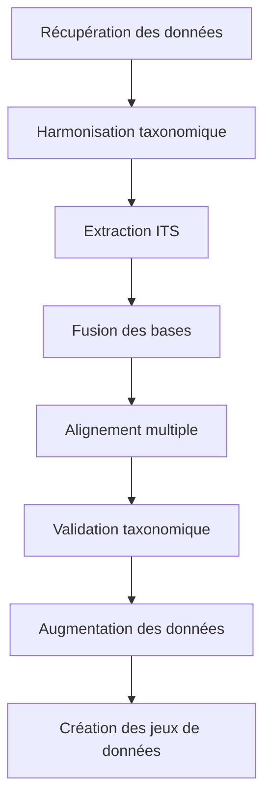

# Vue d'ensemble du pipeline

## Objectif

Ce pipeline bioinformatique a été conçu pour traiter des données de séquençage à haut débit, avec un accent particulier sur les régions ITS (Internal Transcribed Spacer) fongiques. Il permet de :

1. **Récupérer et formater** des données depuis plusieurs bases de référence
2. **Harmoniser la taxonomie** selon le Catalogue of Life (CoL)
3. **Extraire les régions ITS** avec ITSx
4. **Valider les assignations taxonomiques** avec SATIVA
5. **Augmenter les données** pour l'apprentissage automatique avec TRICHE
6. **Générer des jeux de données** prêts pour l'analyse

## Architecture du pipeline

### 1. Récupération et formatage des données

- **Sources supportées** : UNITE, BOLD, PLANiTS, CALeDNA
- **Traitement** :
  - Téléchargement automatique des versions les plus récentes
  - Conversion vers des formats standardisés (CSV/FASTA)
  - Normalisation des métadonnées
  - Attribution d'identifiants uniques (UUID)

### 2. Traitement des séquences

- **Extraction ITS** avec ITSx
- **Alignement multiple** avec MAFFT + TRIMAL
- **Validation taxonomique** avec SATIVA
- **Augmentation des données** avec TRICHE

### 3. Gestion des données

- Stockage dans une base de données PostgreSQL
- Traçabilité complète des transformations
- Génération de rapports détaillés

## Flux de travail

## Avantages clés

- **Reproductibilité** : Environnements conteneurisés et versions figées
- **Évolutivité** : Conçu pour fonctionner sur des clusters HPC
- **Traçabilité** : Chaque transformation est enregistrée
- **Modularité** : Facile d'ajouter de nouvelles règles ou sources de données
