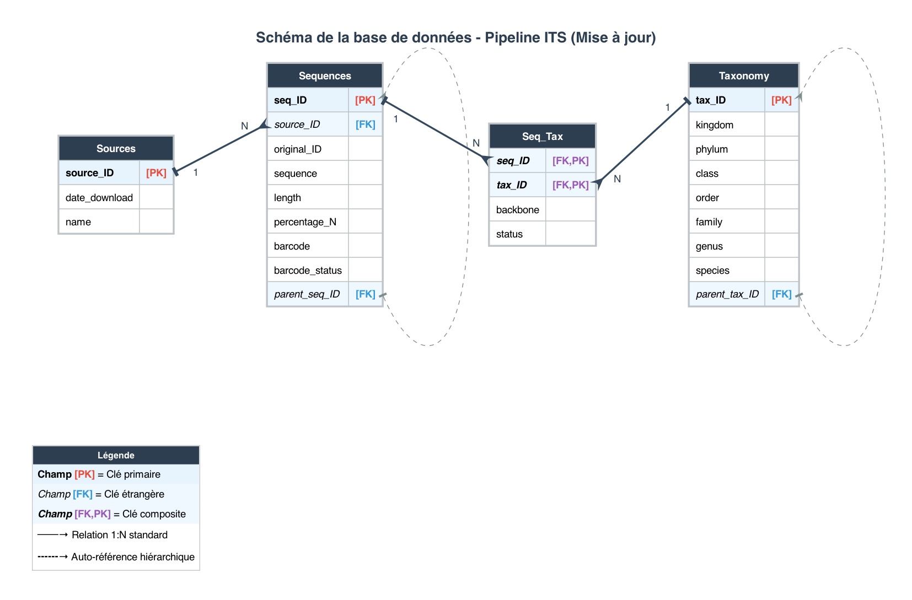

# Documentation de la base de données **Taxonomie & Séquences**

---

## 1. Tables principales

### 1.1 Sources

Contient les informations sur les sources de données (bases externes, fichiers, etc.).

| Colonne             | Type/Info       | Description                         |
| ------------------- | --------------- | ----------------------------------- |
| **source\_ID (PK)** | Clé primaire    | Identifiant unique de la source     |
| **date\_download**  | Date            | Date de téléchargement de la source |
| **name**            | Texte           | Nom de la source                    |

---

### 1.2 Sequences

Stocke les séquences brutes, leurs sous-régions (découpées par ITSx) et leurs métadonnées.

| Colonne                  | Type/Info                 | Description                                                                                              |
| ------------------------ | ------------------------- | -------------------------------------------------------------------------------------------------------- |
| **seq\_ID (PK)**         | Clé primaire              | Identifiant unique de la séquence                                                                        |
| **source\_ID (FK)**      | Clé étrangère → Sources   | Source de la séquence                                                                                    |
| **original\_ID**         | Texte                     | Identifiant original dans la source                                                                      |
| **sequence**             | Texte                     | Séquence nucléotidique                                                                                   |
| **length**               | Entier                    | Longueur de la séquence                                                                                  |
| **%N**                   | Float                     | Pourcentage de bases ambiguës                                                                            |
| **barcode**              | Texte                     | Région du barcode (ITS, ITS1, ITS2, SSU, 5.8S, LSU)                                                      |
| **barcode\_status**      | Texte                     | Statut du barcode (Pending, Duplicate, ITSx) 
| **parent\_seq\_ID (FK)** | Clé étrangère → Sequences | Identifiant de la séquence parente (NULL si séquence originale, rempli si sous-région extraite par ITSx) |

---

### 1.3 Taxonomy

Représente la taxonomie associée à chaque séquence.

| Colonne                  | Type/Info                | Description                               |
| ------------------------ | ------------------------ | ----------------------------------------- |
| **tax\_ID (PK)**         | Clé primaire             | Identifiant unique de la taxonomie        |
| **kingdom**              | Texte                    | Règne                                     |
| **phylum**               | Texte                    | Embranchement                             |
| **class**                | Texte                    | Classe                                    |
| **order**                | Texte                    | Ordre                                     |
| **family**               | Texte                    | Famille                                   |
| **genus**                | Texte                    | Genre                                     |
| **species**              | Texte                    | Espèce                                    |
| **parent\_tax\_ID (FK)** | Clé étrangère → Taxonomy | Taxonomie parente (relation hiérarchique) |

---

### 1.4 Seq\_Tax

Table de liaison entre séquences et taxonomies.

| Colonne              | Type/Info                | Description                                            |
| -------------------- | ------------------------ | ------------------------------------------------------ |
| **seq\_ID (PK, FK)** | Clé primaire / étrangère | Référence vers Sequences                               |
| **tax\_ID (PK, FK)** | Clé primaire / étrangère | Référence vers Taxonomy                                |
| **backbone**         | Texte                    | Provenance de la taxonomie (Raw, CoL, GBIF)            |
| **status**           | Texte                    | Statut du traitement (Pending, Check, Correct, Failed) |

---

## 2. Processus d’intégration (workflow)

### Step 0 : Initialisation de la base

* Création des tables et définition des relations.

---

### Step 1 : Intégration des sources

1. Ajouter chaque source dans la table **Sources**.
2. Ajouter toutes les séquences de la source dans **Sequences**, avec extraction automatique des métadonnées (`length`, `%N`, etc.).
3. Ajouter la taxonomie d’origine pour chaque séquence dans **Seq\_Tax** :

   * `backbone` = `Raw`
   * `status` = `Pending`
4. Sur **Taxonomy**, `parent_tax_ID` reste vide par défaut.
5. Avant d’ajouter une nouvelle taxonomie, vérifier qu’elle n’existe pas déjà pour éviter les doublons.

---

### Step 2.1 : Harmonisation des taxonomies

Les sources initiales (BOLD, UNITE, PLANiTS, CALeDNA) peuvent avoir des taxonomies différentes selon leur politique.
L’objectif est d’aligner ces taxonomies sur une taxonomie officielle (GBIF, CoL).
Dans le cadre de MetaPlantCode, **CoL** est la référence privilégiée.

**Cas de figure pour chaque séquence :**

1. **Taxonomie officielle différente de l’original et absente de `Taxonomy` :**

   * Créer un nouveau `tax_ID` et ajouter la taxonomie corrigée dans **Taxonomy**.
   * Définir `parent_tax_ID` pour lier à la taxonomie parente.
   * Ajouter dans **Seq\_Tax** une nouvelle entrée avec :

     * `backbone` = `CoL`
     * `status` = `Correct`
   * Mettre à jour l’ancienne relation **Seq\_Tax** : `status` = `Check`.

2. **Taxonomie officielle différente de l’original mais déjà présente dans `Taxonomy` :**

   * Mettre à jour la relation d’origine dans **Seq\_Tax** : `status` = `Check`.
   * Ajouter une nouvelle relation dans **Seq\_Tax** (même `seq_ID`, nouveau `tax_ID`) avec :

     * `backbone` = `CoL`
     * `status` = `Correct`.

3. **Taxonomie officielle identique à l’original :**

   * Conserver le même `tax_ID`.
   * Mettre à jour la relation **Seq\_Tax** :

     * `backbone` = `CoL`
     * `status` = `Correct`.

4. **Taxonomie officielle introuvable :**

   * Conserver le même `tax_ID`.
   * Mettre à jour la relation **Seq\_Tax** : `status` = `Failed`.

---

### Step 2.2 : Filtration & déduplication

Une fois toutes les harmonisations effectuées :

1. **Extraction des relations valides**

   * Extraire toutes les relations **Seq\_Tax** avec `status = Correct`.

2. **Détection des doublons**

   * Identifier les doublons selon le triplet : même `sequence`, même `tax_ID`, même `barcode`.
   * our chaque doublon, conserver un seul exemplaire comme référence principale
   * Lister les `seq_ID` redondants à ne pas garder comme référence principale.

3. **Marquage des doublons**

   * Pour les `seq_ID` identifiés comme doublons redondants, mettre dans **Sequences** colonne `barcode_status` la valeur `"Duplicate"`.
   * Les séquences restent présentes dans **Sequences**, aucun enregistrement n’est supprimé pour permettre un retour arrière si nécessaire.

---

### Step 3.1 : Annotation des régions ITS (ITSx)

Une fois les taxonomies harmonisées, chaque séquence est analysée avec **ITSx** pour détecter ses sous-régions (SSU, ITS1, 5.8S, ITS2, LSU).

**Procédure :**

1. Sélectionner toutes les séquences **Sequences** dont `barcode_status` est différent de `"Duplicate"`.
2. Exécuter **ITSx** sur chaque séquence sélectionnée pour détecter ses sous-régions (SSU, ITS1, 5.8S, ITS2, LSU).
3. Pour chaque sous-région détectée :

   * Créer une nouvelle entrée dans **Sequences**.
   * Calculer et renseigner les métadonnées (`length`, `%N`).
   * Renseigner le champ `barcode` avec la sous-région identifiée (ITS1, ITS2, SSU, etc.).
   * Lier la sous-séquence à sa séquence d’origine via `parent_seq_ID`.
   * Remplir le champ `barcode_status` = `"ITSx"`.
   * Créer une entrée correspondante dans `seq_tax` pour relier la sous-séquence à sa taxonomie

⚠️ **Attention pour l’utilisateur de la base de données** : ITSx peut générer des conflits avec l’annotation de la source, par exemple :

* des ITS1 détectés comme ITS2 et réciproquement,
* des séquences complètes ITS où ITSx ne détecte qu’une partie (ITS1 ou ITS2),
* des ITS1 ou ITS2 annoncés par la source mais non détectés par ITSx.

Le choix est fait de **conserver bruts les résultats d’ITSx**, quitte à introduire des doublons avec des barcodes différents (ex. une même séquence représentée comme ITS1 et ITS2).
Il n’est pas réellement possible de trancher automatiquement, mais cette redondance est utile : lors des alignements multiples (MSA), il sera possible d’identifier les séquences qui ne s’alignent pas correctement et ainsi faire un choix plus éclairé du barcode correct à conserver.

---

### Step 3.2 : Filtration & déduplication

Une fois toutes les séquences extraites on a un risque de duplication des séquences:

1. **Extraction des relations valides**

   * Sélectionner toutes les entrées dans `Seq_Tax` où :

     * `status = "Correct"`
     * La séquence associée dans `Sequences` a `barcode_status != "Duplicate"`

2. **Détection des doublons**

   * Identifier les doublons selon le triplet : même `sequence`, même `tax_ID`, même `barcode`.
   * Pour chaque doublon, conserver un seul exemplaire comme référence principale
   * Lister les `seq_ID` redondants à ne pas garder comme référence principale.

3. **Marquage des doublons**

   * Pour les `seq_ID` identifiés comme doublons redondants, mettre dans **Sequences** colonne `barcode_status` la valeur `"Duplicate"`.
